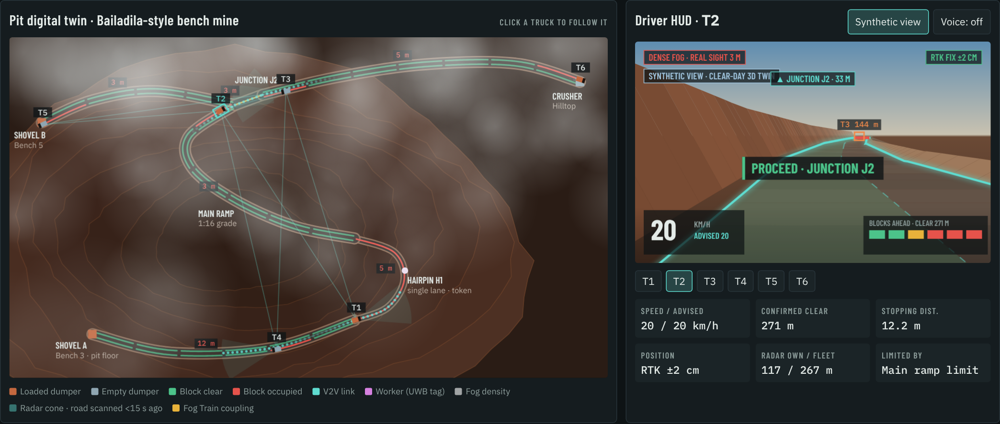
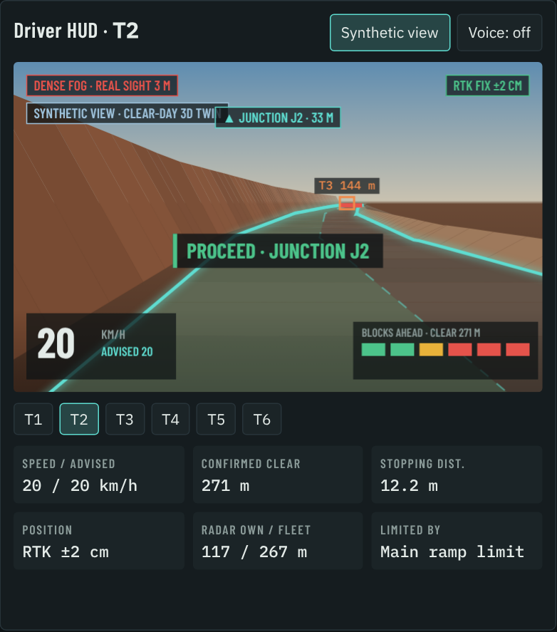

# FogRail

**Instrument flying for haul trucks.** FogRail keeps open-cast mine dumpers hauling safely when fog cuts visibility to 3–5 m.

Smart India Hackathon 2026 · Problem statement **SIH26007** (NMDC Ltd, Bailadila iron ore mines) · Team **LoopHole**



---

## The problem

- In the June–October monsoon, visibility on Bailadila haul roads drops to **3–5 m**.
- A loaded dumper at 30 km/h needs about **20 m to stop**. The driver sees 5 m.
- So trucks crawl or stop, and fog halts haulage for roughly **50–60 days a season**.
- NMDC's own camera-based driver-assist trial at Bacheli improved visibility to about 30–40 m, but operations still stopped. Camera systems are fighting the physics of fog.

## The idea

Pilots land in zero visibility every day. They don't see through cloud; they fly on instruments. FogRail gives every dumper the same kind of cockpit, so the truck's speed is set by what is **known to be clear**, not by what the driver can see.

| Aviation (flying in cloud) | FogRail (hauling in fog) |
|---|---|
| Synthetic vision display | **Synthetic view HUD**: the clear-day 3D road drawn from the truck's own position |
| TCAS (aircraft share positions) | **Fleet radar mesh**: every truck's radar feeds one shared picture of the road |
| Formation / coupled flight | **Fog Train**: V2V-coupled trucks with moving-block gaps |
| ATC weather reports | **Weather mesh**: every truck is a visibility sensor, giving a live fog map and nowcast |
| Instrument procedures and checklists | **Safety core + fail-safe ladder** |

## How it works

### 1. Locate: know where the road is without seeing it
RTK GNSS (NavIC + multi-constellation) and an IMU place each truck on the mine map to a few centimetres. Side radars track the safety berm as a cross-check. If GNSS, IMU and berm radar disagree, the truck slows down.

### 2. Sense: radar first, cameras last
A 77 GHz 4D imaging radar at the front, side berm radars and a thermal camera. Fusion trusts radar more as fog thickens. Cameras are only for recording and the driver's view in light fog.

### 3. Share: the whole fleet is one sensor
Trucks talk directly over V2V (C-V2X sidelink plus a truck-to-truck mesh). No towers or roadside poles. Each truck shares its radar scans, so a truck coming down the hairpin clears the road for the truck going up. A rockfall or person seen by one truck appears on every other truck's HUD as "seen by T4".

### 4. Decide: a deterministic safety core on every truck
- **Virtual blocks**: the haul road is split into blocks, as on a railway. No truck enters a block another truck holds.
- **Right-of-way engine**: single-lane hairpins and junctions pass one token at a time. Loaded, uphill trucks get priority; the other driver sees YIELD and waits at the bay.
- **Safe-speed governor**: speed is set so the stopping distance stays inside the road verified clear:

  `stopping distance = v·tr + v² / 2g(μ·cosθ ± sinθ)` (wet haul road μ ≈ 0.35, reaction tr = 1.5 s)

- It runs fully offline on the truck's edge computer. The network is for sharing, never for braking.

### 5. Guide: eyes up, not head down
A windshield HUD shows the road as it looks on a clear day, the advised speed, blocks ahead, the next turn and YIELD/PROCEED. Haptic seat alerts and voice cues (English and Hindi) cover noisy cabs.



### What happens when things fail

| Failure | Automatic response |
|---|---|
| GNSS lost | IMU + wheel-odometry dead-reckoning, berm radar holds the lane, cap 15 km/h |
| V2V lost | Truck goes "dark": its block and the one behind stay red, neighbours slow |
| Radar fault | Uses the fleet's shared radar picture at 20 km/h (12 km/h where none is fresh) |
| Total comms loss | Controlled stop, wait for the supervisor |

### New roads and people on foot
- **New road cut overnight**: the map stretch is flagged stale. The first truck runs as a pathfinder at 10 km/h on berm radar, and a supervisor approves the new map from its trace.
- **Workers** wear UWB tags that trucks pick up at about 200 m. People without tags are caught by thermal + radar.

## Why it's different

| | Camera driver-assist (NMDC trial) | OEM collision avoidance | Autonomous haulage | **FogRail** |
|---|---|---|---|---|
| Keeps hauling at 3–5 m visibility | Partly | Alerts only | Yes, very costly | **Yes** |
| Sees beyond its own sensors | No | No | Partly | **Fleet radar mesh** |
| Driver sees the road ahead | Enhanced camera | No | No driver | **Clear-day synthetic view** |
| Works on mixed fleets | Yes | Brand-locked | Brand-locked | **Yes, retrofit kit** |
| Roadside infrastructure | None | Some | Heavy network | **None** |

## Prototype

[`prototype/index.html`](prototype/index.html) is a browser simulator of the FogRail control room. It is one HTML file with no build step and no server.

**Run it:** download the file and open it in Chrome, Edge or Firefox. (Fonts load from Google Fonts; everything else is inside the file.)

**What you can do:**
- Watch six dumpers haul between two shovels and a hilltop crusher, over a 1:16 ramp, a single-lane hairpin and a junction.
- Click any truck to see its driver HUD. Toggle **Synthetic view** to compare with raw fog.
- Move the **visibility** slider from 3 m to clear day.
- Inject events: rockfall on the ramp, a tagged worker, an untagged person inside the hairpin, a new road cut.
- Break a truck: GNSS lost, V2V dead, radar fault, total comms loss. Then watch the fail-safe response.
- Use the supervisor controls: stop all trucks, approve a map update, clear a rockfall.
- Compare ore hauled against a **vision-only** baseline (same fleet and fog, speed limited by sight distance) and a **clear-day** reference.

**Simulated results** (3-hour shift, 6 dumpers, 100 t payload):

| Pit visibility | FogRail | Vision-only | Clear day |
|---|---|---|---|
| 5 m (dense fog) | 9,400 t | 3,700 t | 9,900 t |
| 25 m (fog) | 9,700 t | 9,000 t | 9,900 t |

At 5 m fog FogRail keeps about 95% of clear-day output with zero near-misses, against about 37% for vision-only driving. Road geometry, grades, limits and payloads are illustrative, not NMDC survey data.

## Hardware kit (per truck, retrofit)

- RTK GNSS receiver (NavIC + multi-constellation), dual antennas
- IMU / INS + CAN wheel speed
- 77 GHz 4D imaging radar (front), short-range radars (sides and corners)
- Thermal (LWIR) camera in a heated housing with wiper
- V2V radio (C-V2X sidelink + mesh)
- Forward-scatter visibility sensor
- Rugged edge AI computer
- Windshield HUD, haptic seat pad, headset
- Optional brake actuator for Fog Train

## Planned hardware demo (1:10 fog chamber)

- Two RC trucks with ESP32, UWB tag, 24 GHz radar (HLK-LD2450), IMU and ESP-NOW as the V2V link.
- A tablet as the HUD.
- Demos: synthetic view in fog, one truck's radar warning the other around a bend, two trucks coupling into a Fog Train, and a V2V cut falling back to blocks.

## Repository layout

```
README.md            this file
prototype/index.html browser simulator (open directly)
docs/solution.md     full solution write-up, judge Q&A, slide text
docs/images/         screenshots used in this README
```

## Team

Team LoopHole · Smart India Hackathon 2026
